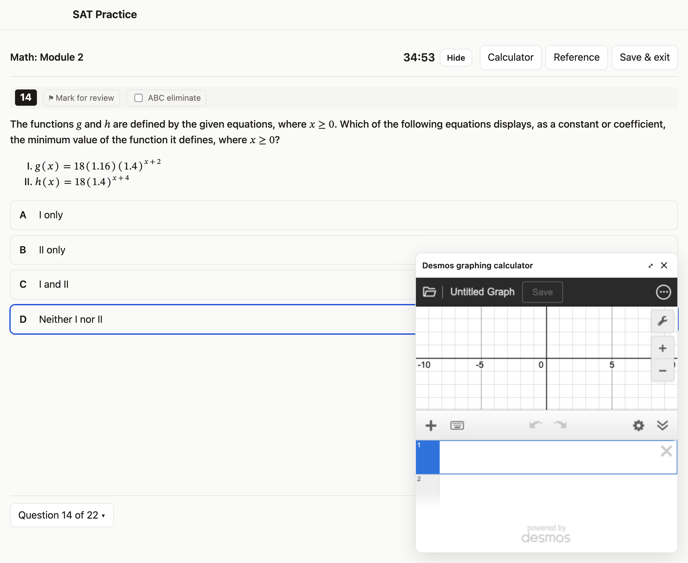
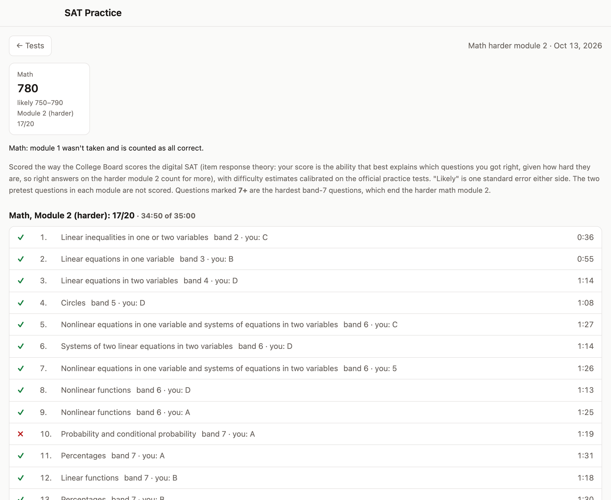

# SAT Practice

Free SAT practice with **every question in the College Board's SAT Suite Question Bank** (about 3,800 Reading and
Writing and Math questions in seven difficulty bands) and **full digital SAT practice tests** built from it in the
Bluebook format. It runs in your browser, phone included, with no account.

**Open it: https://bengreff.github.io/sat-practice/**

| Practice | Practice test | Test results | Stats |
|---|---|---|---|
|  |  |  |  |

## Getting started

1. Open the link. The first time, the questions download from the College Board in the background (about 20
   minutes; the College Board limits how fast). The ones your practice settings ask for come first, so you can start
   right away.
2. **Practice**: answer, check, and read the College Board's explanation. Under **Practice settings**, choose
   sections, difficulty bands, domains and skills, or a preset such as *Hard (bands 6–7)* or *Mistakes & flags*.
   Not sure where to start? Enter your scores under **Plan** for a setup aimed at your level and weak spots.
3. **Tests**: take a full digital SAT, one section, or any single module, for example just the harder Math module 2
   for a quick section score. Tests unlock once their section's questions have downloaded.
4. **Stats** shows your accuracy by band, domain and skill, time per question, and estimated scores.

## Features

**Practice**
- Random questions from a pool you define: sections, bands 1–7, domains and skills (each with a focus weight), and
  status (never answered, missed before, always right, flagged). Least-asked questions come first, with a repeat cap.
- Instant checking with the College Board's explanation, notes on every attempt, flags, answer elimination.
- Grid-ins are checked the way the SAT checks them: equivalent fractions and decimals, and truncated or rounded
  decimals that fill every answer slot.

**Tests** in the Bluebook format
- Reading and Writing in two 32-minute modules of 27 questions, a 10-minute break, then Math in two 35-minute modules
  of 22. Each module has 2 unscored pretest questions, the official mix of domains and skills, about a quarter grid-ins
  in Math, and the official question order (Math from easiest to hardest; Reading and Writing by skill, then
  difficulty).
- Module 2 is harder or easier depending on how module 1 went, as on the real test. The harder Math module 2 ends
  with the hardest questions in the bank.
- Choose any modules: a full test, one section, module 1 only, or a module 2 on its own (module 1 is then counted as
  all correct, or as just missing the harder module for the easier one).
- Desmos graphing calculator, reference sheet, mark for review, question navigator, save and resume; the results
  show every question's difficulty and the time you spent on it.
- Optionally leaves out the questions the College Board uses on its Bluebook practice tests, so you can still take
  those fresh.

**Plan**: enter a score report (section scores and the Knowledge and Skills bars) to get a suggested practice setup.

**Your data**: everything stays in your browser. Nothing is sent anywhere; the only requests go to the College
Board's question bank to download questions. There are no accounts, ads or analytics. Export a progress file under
**Data** to move to another device (imports merge, so nothing is lost), or export the questions so another device
doesn't have to download them.

## How the scores work

The College Board scores the digital SAT with item response theory: each question has a difficulty, your ability is
the value that best explains your right and wrong answers, and a table turns that into a 200–800 score. It doesn't
publish the question parameters, so this app estimates them from official data (`tools/calibrate.py`):

- Nearly all questions of the College Board's paper practice tests 4–11 are also in the question bank (940 of 960
  match, every match agreeing with the official answer key), so each official test's difficulty mix is known.
- The College Board's own question order (Math runs from easiest to hardest) gives the spacing of the seven
  difficulty bands, plus a small effect of solution length within a band. The last questions of the harder Math
  module 2 are drawn from the band-7 questions with the longest official solutions, as on the real test.
- The eight official raw-to-scaled conversion tables give the rest; the model reproduces them to within about 10
  points at 700 and above.
- Routing follows the College Board's Technical Manual: the cut is the median student; the easier module 2 is set so
  that a student just below the cut who gets everything right reaches 580, the maximum the manual reports; the harder
  module 2 is aimed at the students routed to it.

The scores are estimates. Treat them as good to a few tens of points, as with any practice test.

## Optional: the local app

The local app runs the same thing from your computer and saves progress to a file (`progress.json`, with backups),
so it survives clearing the browser and can be shared between browsers.

| System | Run this |
|---|---|
| macOS / Linux (Terminal) | `curl -fsSL https://raw.githubusercontent.com/bengreff/sat-practice/main/install.sh \| bash` |
| Windows (PowerShell) | `irm https://raw.githubusercontent.com/bengreff/sat-practice/main/install.ps1 \| iex` |

The installer puts the app in `~/SATPractice`, adds a desktop launcher and starts it. Running it again updates the
app without touching your progress. It needs Python 3.8+ (the Windows installer installs it if missing).

With the local app running, the website can use its progress and questions too: open **Data › Connect to the local
app** on the website, or **Data › open it connected to this app** in the local app. Chrome asks once to allow access
to apps on your device. Only the published website is allowed to connect.

## For developers

```
git clone https://github.com/bengreff/sat-practice && cd sat-practice && python3 server.py
```

Plain HTML, CSS and JavaScript modules with no build step (`app/`); `server.py` uses only the Python standard
library. Any static host works too (progress then stays in the browser). The repository contains **no question
text**: every device downloads the questions from the College Board's public
[SAT Suite Question Bank](https://satsuitequestionbank.collegeboard.org/). `tools/official-tests.json` holds the answer
keys and conversion tables of the paper practice tests 4–11 (`tools/extract_official.py` rebuilds it from the College
Board's PDFs); it is used only by `tools/calibrate.py`, which derives the scoring constants in `app/scoring.js`.

## Disclaimer

Not affiliated with or endorsed by College Board. SAT is a registered trademark of College Board. Questions, answer
explanations, answer keys and conversion tables belong to College Board. The code is MIT licensed.
