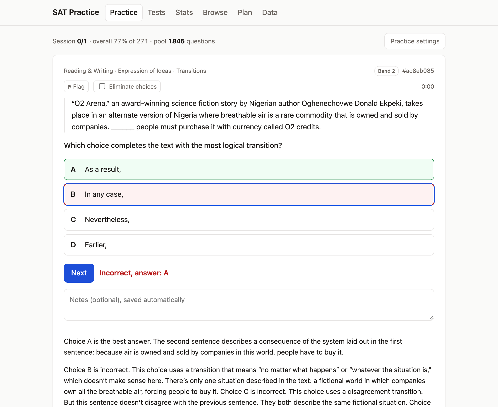
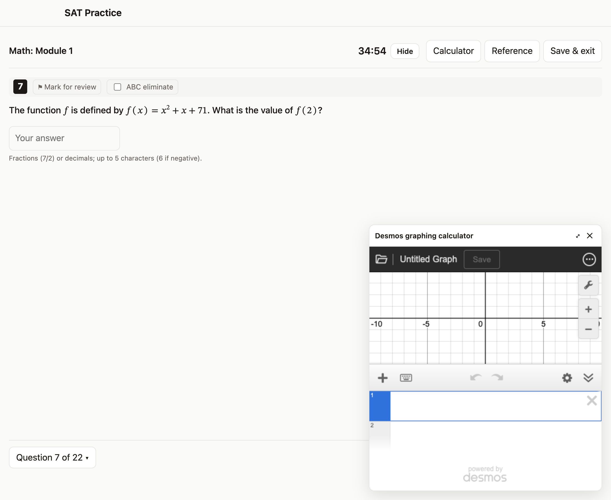
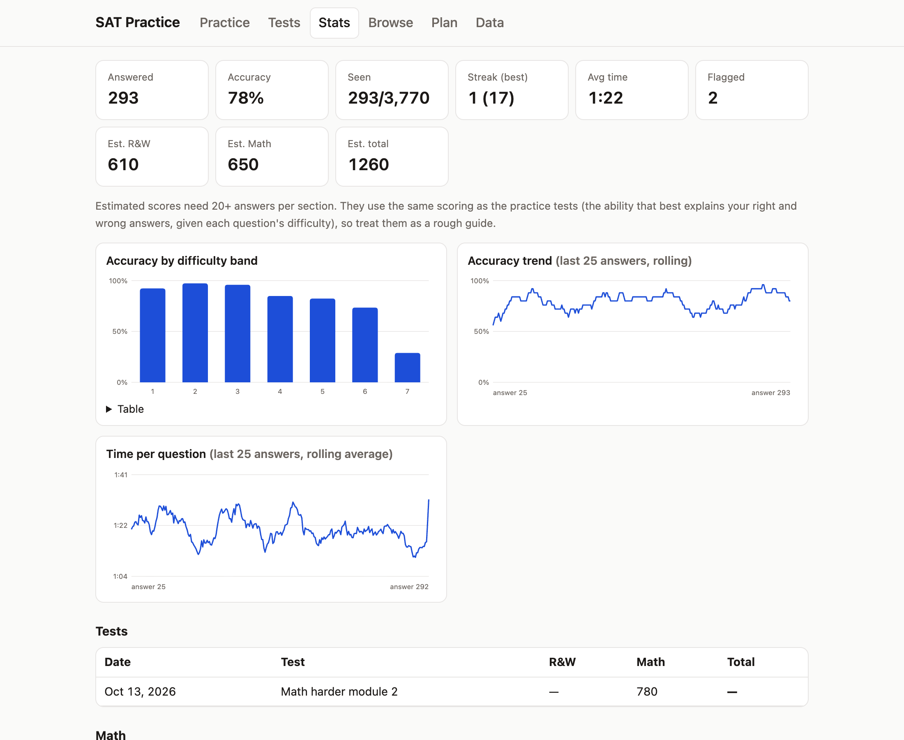

# SAT Practice

Practice with **every question in the College Board SAT Suite Question Bank** (about 3,800 questions across all seven
difficulty bands) and take **digital SAT practice tests** built from it: the Bluebook format, adaptive second modules,
any module on its own, and scoring modelled on the College Board's.

**Open it in any browser, phone included:** **https://bengreff.github.io/sat-practice/**



Or install the local app (saves progress to a file):

| System | Run this |
|---|---|
| macOS / Linux (Terminal) | `curl -fsSL https://raw.githubusercontent.com/bengreff/sat-practice/main/install.sh \| bash` |
| Windows (PowerShell) | `irm https://raw.githubusercontent.com/bengreff/sat-practice/main/install.ps1 \| iex` |

The installer puts the app in `~/SATPractice`, adds a desktop launcher, and starts it. Running it again updates
the app without touching your progress. Python 3.8+ is required (the Windows installer installs it if missing).

## Features

| Practice test with Desmos | Stats |
|---|---|
|  |  |

**Practice**
- Random questions from a pool you define: sections, difficulty bands 1–7, domains and skills (each with a focus
  weight), and status: never answered, missed before, always right, flagged.
- Cap how many times each question can repeat; least-asked questions come first.
- Instant checking with the correct answer and the College Board's explanation; notes on every attempt; flags.
- Presets: hardest only (band 7), hard (6–7), all bands, mistakes and flags, unseen only.
- Grid-in answers are checked the way the SAT checks them (equivalent fractions and decimals, truncated or rounded
  decimals that fill every answer slot).

**Tests**
- *Digital SAT practice tests* built from the bank in the Bluebook format: Reading and Writing (2 × 27 questions,
  32 min each), a 10-minute break, Math (2 × 22, 35 min each). Each module has 25 / 20 scored questions plus 2 unscored
  pretest questions, the official domain and skill mix, about a quarter grid-ins in Math, and the official order
  (Math easiest to hardest; Reading and Writing by skill, then difficulty).
- Module 2 is harder or easier depending on module 1, or pick any modules yourself: for example only the harder Math
  module 2, with module 1 counted as all correct, for a quick section score. The harder Math module 2 ends with the
  hardest questions in the bank (band 7 with the longest official solutions).
- Optionally leaves out the questions the College Board uses on its Bluebook practice tests, so those stay fresh.
- Test-day tools: Desmos graphing calculator, math reference sheet, mark for review, answer elimination, question
  navigator, timers that survive reloads, save-and-resume; results show the time spent on every question.

**Stats**
- Accuracy, streaks, time per question (counted only while you're on the question), estimated section and total scores.
- Charts of accuracy by difficulty band, accuracy over time, and time per question over time.
- Accuracy and coverage by section, domain and skill; weakest skills; history of every test.

**Plan**
- Enter a score report (section scores plus the Knowledge and Skills domain bars) and get a suggested practice
  configuration you can apply with one click.

**Data**
- Export and import progress files to move between devices (imports merge; nothing is lost).
- Export and import the downloaded questions so another device doesn't need to download them again.

## Website + local app on the same computer

If the local app is running, the website can use its progress and questions, so both show the
same data. Connect once per browser: in the local app open **Data → open it connected to this app**, or on the
website open **Data → Connect to the local app**. Chrome asks once to allow access to apps on your device. After
that, opening the website while the local app runs shows *Connected to your local app* in the header, and every
answer is saved to the local `progress.json`. Only the published website is allowed to connect.

## Where the content comes from

This repository contains **code only**. No question text is stored here.

- **Questions** are downloaded on each device from the College Board's public
  [SAT Suite Question Bank](https://satsuitequestionbank.collegeboard.org/). The College Board limits request rates,
  so the first full download takes about 20 minutes. You can practice while it runs, and the hardest questions
  arrive first.
- `tools/official-tests.json` holds the answer keys and score conversion tables of the College Board's paper practice
  tests 4–11 (`tools/extract_official.py` rebuilds it from the PDFs). It is used only to calibrate the scoring.

## Scores

The College Board scores the digital SAT with item response theory: each question has a difficulty, your ability is
the value that best explains your right and wrong answers, and a table turns it into a 200–800 score. It doesn't
publish the question parameters, so `tools/calibrate.py` estimates them from official data:

- Nearly all questions of the paper practice tests 4–11 are in the question bank (940 of 960 match, every match
  agreeing with the official key), so each test's difficulty mix is known.
- The College Board's own question order (Math runs easiest to hardest) gives the spacing of the seven difficulty
  bands, plus a small effect of solution length within a band.
- The eight official conversion tables give the spread, the guessing level and the ability-to-score curve (within
  about 10 points at 700+).
- Routing follows the Technical Manual: the cut is the median student; the easier module 2 is set so that a student
  just below the cut who gets everything right reaches 580, the documented maximum; the harder module 2 targets the
  students routed to it.

So scores are estimates. Treat them as within a few tens of points, as with any practice test.

## Running from a clone

```
git clone https://github.com/bengreff/sat-practice && cd sat-practice && python3 server.py
```

Progress is kept in `progress.json` (merged on every save, backed up to `backups/` on each start and reset).
The app itself is plain HTML, CSS and JavaScript modules with no build step; `server.py` uses only the Python
standard library.

## Disclaimer

Not affiliated with or endorsed by College Board. SAT is a registered trademark of College Board. Questions, tests,
answer keys and conversion tables belong to College Board. Code is MIT licensed.
